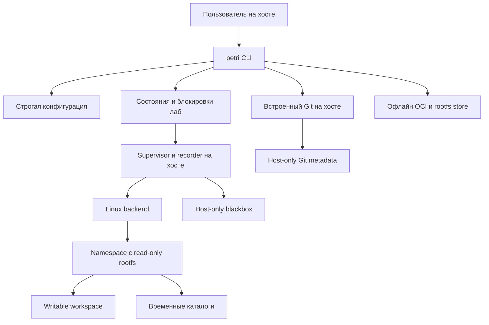

# ТС — Technical Specification — Petri v0.3

Дата: 2026-10-25 UTC. Совместно с [ТЗ v0.3](requirements.md) задаёт техническую основу проекта. Это описание архитектуры и границ текущего среза; доказательства готовности находятся в [status.md](status.md). Отступления от ТС v0.1/v0.2 пронумерованы в [decisions.md](decisions.md).

## 1. Компоненты



Rust 1.99.1 CLI использует clap, serde/serde_json, строгий YAML-парсер serde-saphyr 2 (deserialize-only, без include/properties), UUID и встроенные криптографические хеши. Git операции выполняются через `git2`/vendored libgit2 без системного executable. Linux backend использует libc непосредственно. Нет зависимости базового runtime от Docker Desktop или внешнего `unshare`.

Пакет собирается Cargo; lockfile фиксирует реально разрешённые зависимости. Версия Rust в `Cargo.toml` является поддерживаемым минимумом только после отдельной проверки MSRV. Сборка текущим компилятором сама по себе не доказывает MSRV.

## 2. Хранилище и границы

Путь задаётся `--home`, затем `PETRI_HOME`, затем платформенным application-data каталогом. Нельзя считать буквальное `~/.petri` универсальным путём на всех ОС. Команды и примеры могут использовать явный `--home /absolute/path` для воспроизводимости.

```text
<home>/
  labs/<lab-id>/
    meta.json                  # host-only состояние и provenance
    workspace/                 # единственное постоянное дерево исходников лабы
    git/                       # независимые Git-объекты/refs, не монтируются внутрь
    blackbox/
      events.jsonl             # управляющие события supervisor
      terminal.cast            # запись захваченного вывода; см. ограничения capture
    checkpoints/<cp-id>/
      workspace/
      git/
      meta.json
    supervisor.pid             # диагностика; не самостоятельное доказательство identity
  locks/<lab-id>               # взаимное исключение host operations
  stacks/                     # ссылки имён, content-addressed rootfs, staging
```

`/logs` внутри sandbox остаётся пустым read-only каталогом rootfs: управляющий `blackbox` на хосте туда не монтируется. Параметр пути logs в API runtime используется для проверки разделения путей, а не для bind-mount. Метаданные, записи recorder и Git недоступны агенту.

На Unix каталоги состояния создаются с правами 0700, управляющие файлы — 0600. Проверяются symlink у управляющих путей. Защита от недоверенного процесса внутри sandbox обеспечивается отсутствием хостового корня; от произвольного хостового процесса с тем же UID эти права не защищают. Канонизация путей и проверки файла не заменяют openat2/O_NOFOLLOW во всех сценариях гонок; такое усиление остаётся отдельной security-задачей.

## 3. Лабы, состояния и операции

Состояния как минимум различают подготовленную лабу, запуск, реально выполняемую нагрузку, успешное завершение и ошибку. Конкретные имена сериализуются в `meta.json`. Запуск не переводит лабу в успешное состояние по факту создания каталога.

Создание:

1. Загрузить и проверить конфигурацию, разрешить имя стека.
2. Проверить источник как локальный Git-репозиторий с HEAD.
3. Создать private каталог, отдельные Git-метаданные и workspace из tracked HEAD.
4. Записать base commit, stack digest, task hash и время создания.
5. При `--prepare` остановиться в подготовленном состоянии без исполнения.
6. При команде запуска вызвать supervisor; обязательные setup-ошибки возвращаются вызывающему процессу.

Исполнение — отдельный процесс Petri с явно сохранёнными аргументами, не shell-конкатенация пользовательских строк. Supervisor владеет блокировкой лабы, регистрирует переходы состояния и код выхода, читает stdout/stderr. Background mode требует живого supervisor; PID-файл является диагностикой. После аварии состояние может требовать ручного восстановления; это не маскируется автоматическим `Stopped`.

Для операций изменения состояния используется блокировка. Diff/commit/checkpoint/restore/discard не читают меняющийся workspace работающего агента как согласованный снимок. Идентификаторы валидируются по фиксированному формату, traversal запрещён. Удаление ограничено каталогом конкретной остановленной лабы.

## 4. Linux Runtime

Обязательные свойства:

- user namespace с явной картой доступного UID/GID;
- private mount propagation, отдельные mount/PID/network/IPC/UTS namespaces;
- отдельный корень через безопасную последовательность bind/pivot_root и detach старого корня;
- read-only rootfs; writable workspace и выделенные tmpfs/данные лабы;
- безопасно настроенные `/proc` и `/dev`, отсутствие хостовых файловых дескрипторов, отсутствующая внешняя сеть;
- `PR_SET_NO_NEW_PRIVS`, снятие capabilities и seccomp с проверкой архитектуры;
- применение заявленных rlimits до exec;
- корректный код выхода и cleanup при неуспехе установки любого обязательного ограничения.

Stack содержит настоящие каталоги mount targets `workspace`, `logs`, `tmp`, `proc`, `dev`, `run`, `.petri-oldroot`. Symlink вместо mount target недопустим. Не создаются host devices из импортируемого архива. Программы rootfs могут читать библиотеки и инструменты; read-only не означает запрет чтения.

Процесс внутри нового PID namespace требует корректного поведения PID 1: ожидание потомков, обработка сигналов, завершение всех процессов при выходе. Без этих свойств lab нельзя считать остановленной только по завершению одной команды.

`memory_bytes` означает RLIMIT_AS — virtual address space на процесс, `cpu_seconds` означает RLIMIT_CPU, `max_processes` связан с RLIMIT_NPROC. Они не являются cgroup limits всей лабы. Node/JVM и другие программы, резервирующие большие объёмы виртуальной памяти, могут требовать настройки RLIMIT_AS даже при небольшом RSS. Landlock ABI >=3 обязателен и устанавливается после pivot_root с разрешением чтения/исполнения rootfs и записи workspace/tmp/dev. Cgroup v2 CPU/RAM/PIDs остаётся отдельным расширением; создание cgroup namespace не создаёт контроллеры лимитов.

`doctor` выполняет диагностику, не запускает пользовательскую нагрузку на хосте. Отрицательная диагностика внешнего контейнера является ограничением среды. Положительный probe userns не заменяет полный тест mount/seccomp/rootfs.

## 5. GitManager

Данные исходника материализуются из Git blobs, а не посредством shell checkout, hooks или filters. Git-метаданные лабы расположены вне её rootfs. Нет общего writable `.git` с исходником и нет копирования host credential configuration.

`create_workspace` фиксирует исходный HEAD. `diff` сравнивает фактические файлы с известным деревом. `commit` создаёт локальный commit в отдельном lab repository. Неотслеживаемые безопасные файлы лабы могут войти в diff/commit; секретные пути и опасные ссылки проверяются. Неотслеживаемые/dirty исходные файлы не импортируются автоматически.

`merge --yes` текущего среза публикует локальную review-ветку исходного репозитория: не двигает main и не меняет исходное рабочее дерево. Это инженерное уточнение исходного слова merge. Повторное применение, конфликт существующего ref или несовпадение базы должны завершаться безопасным отказом. Создание PR, network push и произвольный Git внутри лабы не реализуются универсальным RPC. Для будущего broker необходимы типизированные операции и привязка авторизации к конкретной lab/remote/ref.

Недопустимые пути проверяются по компонентам. Симлинки не могут указывать наружу workspace или на закрытые Git/секретные пути; отсутствует следование ссылкам при сканировании. Submodule отклоняется до наличия отдельной безопасной модели. Не заявляется идентичность обычному shared Git worktree.

## 6. StackHub

Поддержанные входы — локальный rootfs и OCI Image Layout. Имя стека — валидированный идентификатор, а не произвольный путь. Импорт работает через staging и публикует ссылку только после полного успеха.

OCI импорт проверяет:

1. `oci-layout` и поддержанный `imageLayoutVersion`.
2. `index.json`, поддержанное число manifests и media types.
3. SHA-256 и размеры каждого descriptor, конфигурацию OS/architecture.
4. SHA-256 распакованных слоёв (`rootfs.diff_ids`), допустимый compression.
5. Безопасность каждого tar entry, суммарный expanded size и количество entries.

Текущий безопасный поднабор может отклонять whiteout, hardlinks и специальные entries. Это ограничивает число совместимых OCI-образов, но предпочтительнее неполного применения слоёв. Ошибка не публикует частично распакованный стек. Последовательное применение слоёв не должно записывать через симлинк, созданный предыдущим слоем.

После нормализации rootfs вычисляется content digest с учётом путей, типов, содержимого, executable permissions и ссылок. Read-only seal на диске — дополнительная защита от случайных изменений хостом; реальная защита от sandbox обеспечивается read-only mount. Одинаковый digest повторно использует rootfs. Это не заявление о поблочной hardlink-дедупликации всех разных образов.

Хранилище не доверяет подписи по одному digest. Registry auth/pull, cosign, SBOM, layer garbage collection, воспроизводимый builder, Dockerfile и Docker save import остаются отдельными задачами. Удаление имени стека не должно удалять rootfs, используемый существующей лабой.

## 7. Конфигурация `petri.yaml`

Актуальная схема:

```yaml
stack: alpine-local
policy:
  network: []
  deny_paths: [".env", ".env.*", ".ssh"]
  memory_bytes: 1073741824
  cpu_seconds: 300
  max_processes: 128
```

`network: []` означает отсутствие внешней сети. Непустой массив до реализации enforcing network backend возвращает NotImplemented. Старый верхнеуровневый `network`, выражение `except`, секции syscalls/secrets и неподдержанная wildcard-грамматика не игнорируются молча.

Парсер `deny_paths` распознаёт точный компонент имени либо непустой префикс с завершающим `*`, но пользовательские изменения списка сейчас отклоняются: правило ещё не проведено через все Git snapshots. Допускается безопасный стандартный список из примера; базовые исключения `.env`, `.env.*`, `.ssh`, `docker.sock` не отключаются. Это политика экспорта/обработки файлов на хосте, не правило Landlock и не обязательное запрещение агенту создать новый файл с таким именем в своём workspace. Содержимое иных файлов автоматически не классифицируется как секрет.

Лимиты положительны и проверяются на представимость. Размер конфигурации ограничен; неизвестные поля запрещены. Неиспользуемое правило безопасности должно приводить к отказу, а не к декоративной записи в metadata.

## 8. Blackbox и provenance

Управляющие события сериализуются как JSONL с временем, типом и необходимыми данными. Вывод child capture хранится отдельно, запись asciinema-подобного потока допускает воспроизведение задержек захвата. Pipe capture не сохраняет интерактивный stdin, resize, TTY-семантику и точный единый порядок одновременных stdout/stderr. Бинарный вывод может преобразовываться для сериализации; точный byte-for-byte аудит не обещается без отдельного формата.

Нельзя выдавать поле `process_spawn` или `network_blocked` за наблюдавшееся kernel-событие, если оно синтезировано supervisor. Полный eBPF/fanotify аудит не входит в текущую реализацию. Цены/токены/модель неизвестны при запуске произвольного executable; отсутствующее значение не заменяется вымышленной моделью.

Provenance: base commit, normalized stack digest, task hash, заданная команда, время, код выхода. Git trailers дополняют эти данные и не являются цифровой подписью. Cache hit и IPFS publication не выполняются до отдельной безопасной реализации. Vault secrets не передаются, так как Vault сейчас не реализован; этого недостаточно, чтобы обещать отсутствие секретов, которые пользователь сам поместил в исходник или стек.

## 9. Checkpoint/restore

Снимок создаётся только при отсутствии активной нагрузки и под блокировкой. Файлы копируются без следования внешним ссылкам и без writable hardlinks к источнику. Git metadata копируется вместе с workspace. Snapshot ID и описание записываются в metadata; staging переименовывается после завершения копирования.

Restore сначала готовит замену, затем сохраняет старые деревья до успешного переключения обоих каталогов. При обычной ошибке rename выполняется rollback. Аварийное завершение между несколькими rename требует обнаружения staging/previous и явного восстановления; несколько файловых rename не являются одной атомарной транзакцией. Эта граница должна быть видна пользователю, а до полноценного journaled recovery не заявляется crash-proof restore.

## 10. CLI и API

Интерфейс текущего среза:

```text
petri [--home PATH] doctor
petri create TASK --repo PATH --stack NAME --prepare
petri create TASK --repo PATH --stack NAME [--detach] -- PROGRAM ARG...
petri run LAB [--detach] -- PROGRAM ARG...
petri list [--json] [--all]
petri diff LAB [--json]
petri logs LAB [--replay]
petri commit LAB --message MESSAGE
petri checkpoint LAB [MESSAGE]
petri restore LAB CHECKPOINT
petri merge LAB --yes
petri discard LAB
petri link LAB --project PATH
petri stack import-rootfs NAME PATH
petri stack import-oci NAME PATH
petri stack list
petri stack rm NAME
```

CLI help является источником точного синтаксиса. Агент запускается как явно выбранный executable из стека; имя `claude` само по себе не устанавливает и не авторизует адаптер. Секреты не берутся из host env автоматически.

Команды будущих возможностей (`stack pull/build`, Vault, secret add/allow, Docker import/forwarding, dashboard, PR creation, logs follow) обязаны возвращать явный отказ до появления backend. Наличие имени команды не является её реализацией.

`petri compat up` обслуживает Unix socket в foreground, без фоновой установки сервиса. Права сокета 0600, home private; существующий socket или symlink не удаляется автоматически. Длина заголовков ограничена 8 КиБ, время чтения — 2 с. HTTPS/TCP endpoint не открывается. На не-Unix ОС — Unsupported.

| Метод | Route (без префикса либо с `/v1.44`) | Семантика |
| --- | --- | --- |
| GET, HEAD | `/_ping` | Discovery, без запуска контейнера |
| GET | `/version` | Версия Petri и указание read-only subset |
| GET | `/info` | Сводка лаб; предупреждение об ограничениях |
| GET | `/containers/json` | Только Running; `?all=1` или `?all=true` включает остановленные |
| GET | `/containers/{lab-id}/json` | Inspect метаданных, не настоящий Docker container state |
| Любой неподдержанный | Включая `DELETE /containers/{id}`, create/start/stop/logs/wait, images/networks/volumes/build/exec | 501 JSON, без мутации |

Неверный ID — 400, неизвестная лаба — 404, ошибка хранения — 500. Список не выдаёт `Pid` лабы за реальный host PID и не выдаёт read-only discovery за Docker runtime. Compose не поддерживается.

## 11. Vault и остальные целевые расширения

Vault требует отдельного аутентифицированного протокола, OS Keychain или проверенного 1Password backend, scopes, аудита решений и взаимодействия с реальной биометрией. PID/cgroup credentials Unix peer нельзя механически перенести на vsock гостевой VM; там потребуется отдельная доверенная идентичность. Broker-push выполняет строго авторизованную операцию; shared SSH agent без destination restrictions недостаточен.

Сетевой allowlist, групповые cgroup-лимиты, Mac VM, WSL2, агентские adapters, circuit breaker, результатный кэш, transport Git, подписи и дистрибуция добавляются отдельными вертикальными срезами с тестами. Ни одна из этих функций не выводится из одного наличия trait, enum или конфигурационного поля.

## 12. Сборка и проверка

Локально: `cargo build`, `cargo test`, `cargo fmt --check`, `cargo clippy --all-targets -- -D warnings`. Network для загрузки зависимостей и toolchain относится к сборке, а не к обещанной сети внутри лаборатории. Release binary собирается `cargo build --release`; размер проверяется по готовому артефакту.

Unit/integration тесты используют временные каталоги и локальные репозитории. Вредоносные tar/path fixtures не должны читать секреты хоста. Проверки namespace запускаются opt-in на пригодном Linux runner; неподдержанный внешний контейнер даёт диагностический отказ. Destructive smoke test никогда не запускает `rm -rf /` на хосте и не должен ослаблять защиту ради прохождения теста.

CI разделяет переносимые тесты, компиляцию платформ, настоящий runtime E2E и релизные гейты. `cargo audit` требует актуальной advisory database; coverage требует инструмента и отчёта. До фактического измерения нельзя писать «>80%», «нет уязвимостей», «p95 <4 с» или «3 ОС проверены». [Матрица статуса](status.md) фиксирует эти ограничения.
